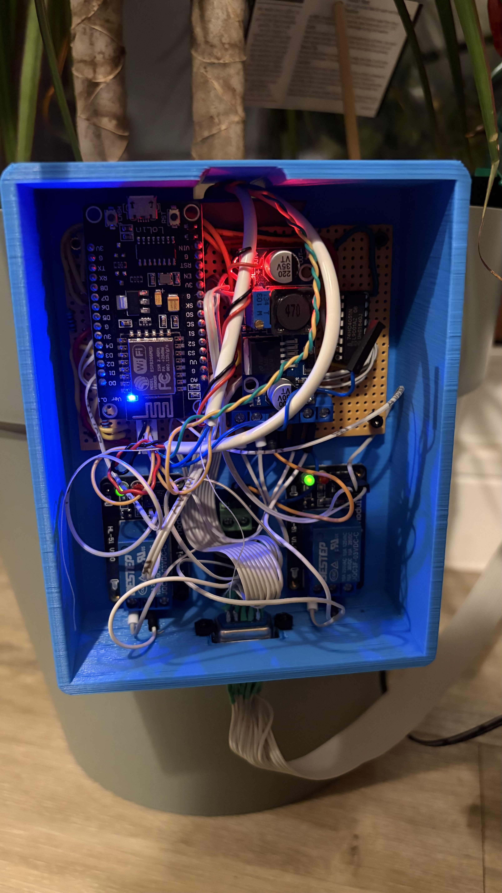

# Watering System

[](https://github.com/ScottGibb/Watering-System/actions/workflows/kicad.yaml)
[](https://github.com/ScottGibb/Watering-System/actions/workflows/wireviz.yaml)
[](https://github.com/ScottGibb/Watering-System/actions/workflows/mega-linter.yaml)
[](https://github.com/ScottGibb/Watering-System/actions/workflows/release-please.yaml)

## System Diagram


Hardware for a watering system split across two boards, linked by a multicore
cable:

- **Main Board** contains the controller and main watering-system circuitry.
  Open [main-board/main-board.kicad_pro](main-board/main-board.kicad_pro).
- **Connector Board** breaks out the multicore cable to the external connections.
  Open [connector-board/connector-board.kicad_pro](connector-board/connector-board.kicad_pro).

Each folder contains a matching `.kicad_pro`, `.kicad_sch`, and `.kicad_pcb`.
Use KiCad 10 to open the projects. CI currently checks and releases schematics;
PCB checks and fabrication outputs are not enabled.

[Wiring harnesses](wiring/README.md) are maintained separately in `wiring/` using
WireViz, including confirmed pin mappings and explicitly unresolved physical details.

## Veroboards and Pictures

The populated main veroboard, ESP8266 controller and relay modules installed in
the electronics case:



## CAD files

CAD files and printable parts for the watering-system cases:

| Case | Thingiverse | Printables |
| --- | --- | --- |
| Veroboard Ribbon Enclosure | [Files](https://www.thingiverse.com/thing:7423750) | [Files](https://www.printables.com/model/1882002) |
| Plant Pot PIR Sensor Case | [Files](https://www.thingiverse.com/thing:7423472) | [Files](https://www.printables.com/model/1880769) |
| Plant Pot Electronics Case | [Files](https://www.thingiverse.com/thing:7423784) | [Files](https://www.printables.com/model/1882130) |

These listings were last recorded as drafts; links may be unavailable until
the models are published.

## External hardware

Component links and references for the build. Supplier examples are not a
complete BOM; check supply voltage, pinout and dimensions against the wiring
documentation and your actual parts.

- **Moisture sensors:** [capacitive soil moisture sensor](https://thepihut.com/products/capacitive-soil-moisture-sensor)
  for the outdoor probes; the indoor probe uses a resistive sensor.
- **Relays:** two HL-51 V1.0 single-channel modules
  ([module CAD reference](https://grabcad.com/library/relay-module-1-1)).
- **Water pumps:** two low-voltage DC pumps
  ([example submersible pump](https://thepihut.com/collections/maker-store/products/submersible-3v-dc-water-pump-vertical-type));
  the exact installed pump model is unconfirmed.
- **PIR sensor:** [AM312 mini PIR sensor](https://247geek.co.uk/am312).
- **ESP8266 controller:** [NodeMCU LoLin V3 board examples](https://www.az-delivery.uk/collections/nodemcu).

## KiCad libraries and drawing sheets

After cloning the repository, initialise the pinned library submodule:

```sh
git submodule update --init --recursive
```

Main Board registers the vendor ESP8266 symbol and footprint libraries as
`ESP8266` through its project-local `sym-lib-table` and `fp-lib-table`.
Both use `${KIPRJMOD}/../vendor/` paths, so no machine-specific library
configuration is required. Close and reopen the project if its editors were
already open when the library tables changed.

- Symbol library: `ESP8266` (legacy `.lib`, including `NodeMCU1.0(ESP-12E)`
  and `NodeMCU_1.0_(ESP-12E)`).
- LOLIN V3 footprint: `ESP8266:NodeMCU-LoLinV3`.

The vendor library has a LOLIN V3 footprint but no dedicated LOLIN V3 symbol.
Verify the symbol pin mapping against the actual board before assigning that
footprint; registering the libraries does not place or connect a module.

Main Board references the shared drawing sheet in
`templates/scott-gibb-template.kicad_wks` using a project-relative path.
Connector Board retains its embedded copy of the drawing sheet.

## Continuous integration

CI runs ERC for both boards and exports schematic PDFs, SVGs, BOMs, and netlists.
Artifacts are named per board and retained for seven days. MegaLinter checks
Markdown, YAML, JSON, and workflows.
WireViz builds harness diagrams and BOMs, with seven-day artifact retention.

## Independent board releases

Release Please manages separate versions, changelogs, release PRs, and GitHub
releases for each board. Tags use `main-board-v1.0.0` and
`connector-board-v1.0.0` formats. Both boards start at version `1.0.0`.

Use conventional commits such as `fix(main-board): correct sensor wiring`.
Changed file paths determine which board is released. After successful KiCad
checks, each release receives its own schematic exports and ERC report.
Wiring has an independent version and changelog with `wiring-v*` tags; its releases
receive a ZIP of harness YAML, diagrams and BOMs.
